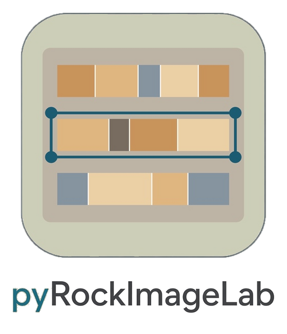
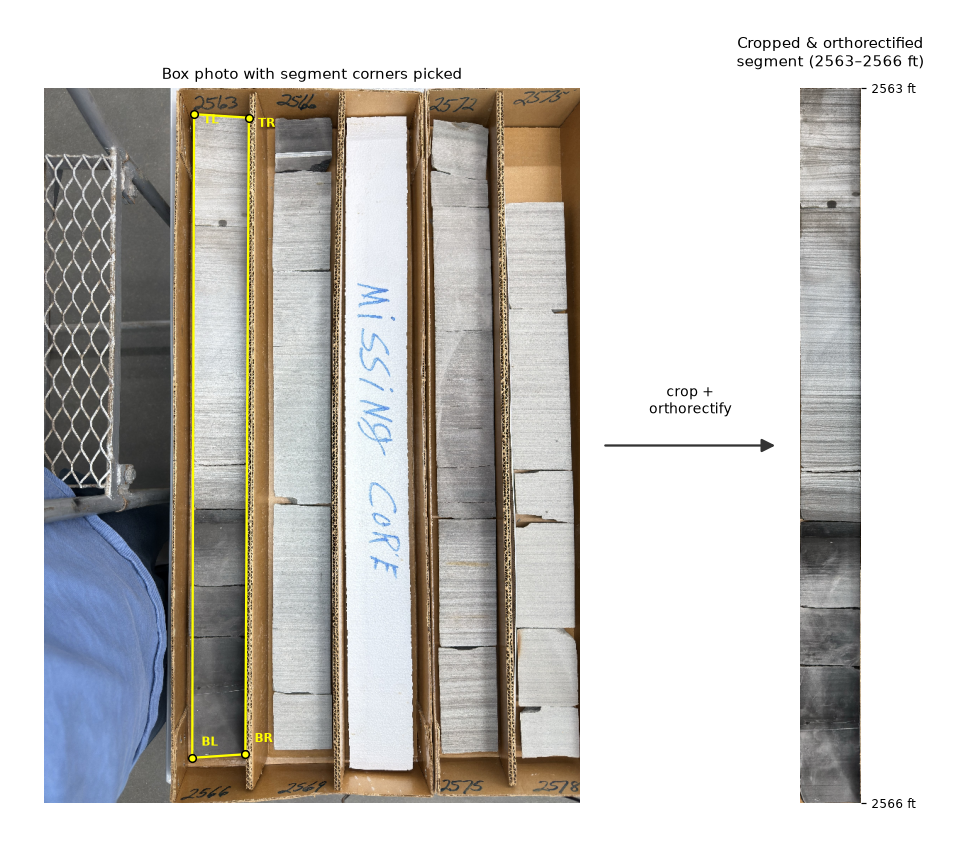
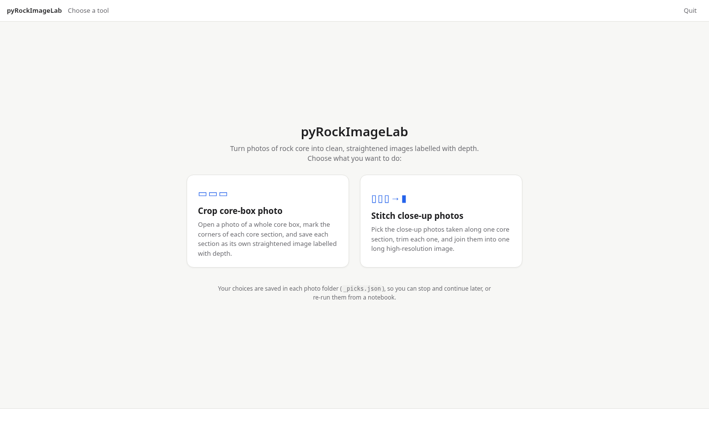
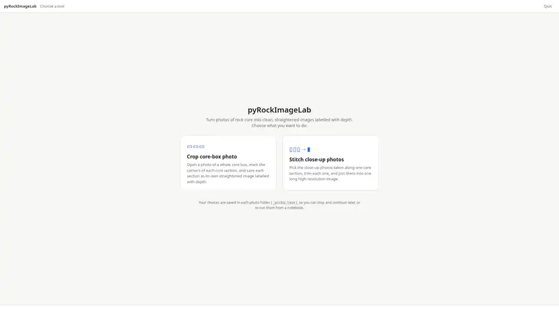
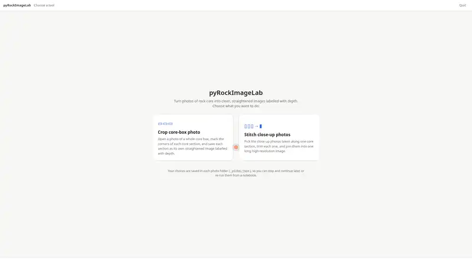
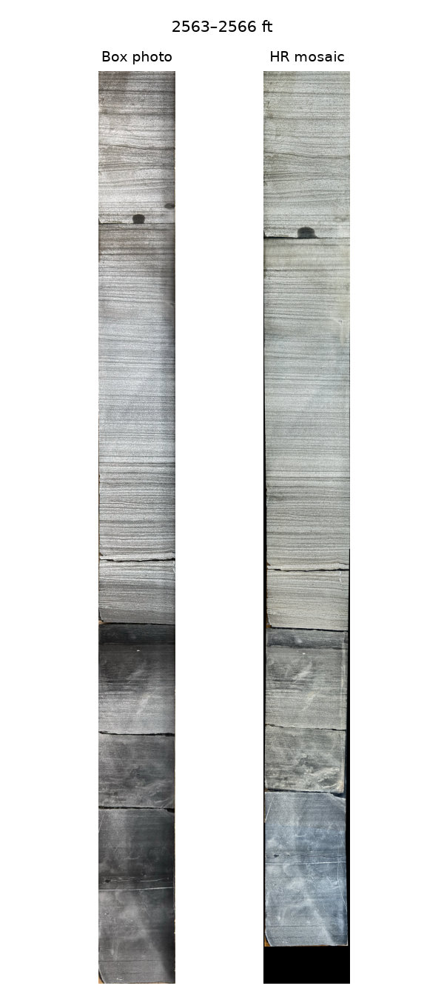

<p align="center"></p>

# pyRockImageLab

[](https://doi.org/10.5281/zenodo.23656974) [](https://pypi.org/project/pyrockimagelab/) [](https://pepy.tech/project/pyrockimagelab) [](./LICENSE)

v0.1.0

**pyRockImageLab** (`import pyrockimagelab`) turns geological core photographs into clean, depth-labelled images. It crops each core section out of a photo of a whole core box, and it joins (stitches) close-up photos of one section into one long high-resolution image. A small browser app does the clicking; the package functions do the rest, also from notebooks with no windows.

> [!NOTE]
> Filesystem paths are required. The package does not ship defaults for a core-image root or any project-specific folder. Pass `folder`, `core_images_dir`, or `--root` from your notebook or CLI.



*Left: the four corners of one core section on a box photo. Right: the cropped, straightened section (2563–2566 ft, example data in `example_data/ExampleCore`).*

Contact:

Larry Syu-Heng Lai (larrysyuhenglai@gmail.com)  
The project was initiated when Larry was affiliated at the [Quantitative Clastics Laboratory](https://qcl.beg.utexas.edu/), Bureau of Economic Geology, The University of Texas at Austin

## Installation

From [PyPI](https://pypi.org/project/pyrockimagelab/):

```bash
pip install pyrockimagelab
```

From this repo:

```bash
conda env create -f environment.yml
conda activate pyrockimagelab
pip install -e ".[heic]"
```

No Qt or other GUI toolkit is needed; the app runs in your web browser.

## Citation

Lai, L.S.-H. (2026) pyRockImageLab. *Zenodo*, [https://doi.org/10.5281/zenodo.23656974](https://doi.org/10.5281/zenodo.23656974)

## Key Features

- Browser app `pyrockimagelab-app` with two tools: **Crop core-box photo** and **Stitch close-up photos**.
- Crop each core section from a box photo by its four corners and straighten it (`ortho_warp_quad`).
- Join close-up photos along one section into one high-resolution image (`stitch_chain`).
- Every corner you mark is saved in `_picks.json` in the photo folder, so notebooks and the command line can re-create the same images without any clicking.
- Command-line entry points: `pyrockimagelab-app` (the app) and `pyrockimagelab` (re-create images from saved corners).

## The app

```bash
pyrockimagelab-app /path/to/CoreImages
```

This opens the app in your web browser (stop it with **Quit**, or Ctrl+C in the terminal). The start screen offers two tools:

- **Crop core-box photo** — Open a photo of a whole core box, mark the corners of each core section, and save each section as its own straightened image labelled with depth.
- **Stitch close-up photos** — Pick the close-up photos taken along one core section, trim each one, and join them into one long high-resolution image.



Both tools start the same way: in **Choose a folder**, type the project folder (laid out as `Project / Well name / start-end`) and press **Show photo folders**. Every depth folder is listed with what is already done; click the one to work on.

**Crop core-box photo**

This tool cuts each core section out of a photo of a whole core box. Watch it once, then follow the steps below.

[](figures/videos/pyRockImageLab_crop_demo.mp4)

*Sped-up demo. Click it to [watch the 1080p video](figures/videos/pyRockImageLab_crop_demo.mp4) (about 40 seconds).*

1. *Choose the box photo* — click the photo of the whole core box, then press **Use this photo**.
2. *Mark core sections* — set how many core sections the box holds, then click the four corners of each section (drag a corner to adjust). Type each section's length in feet; the depth and file name fill in automatically. **Preview** shows the straightened section.
3. *Saved images* — press **Save 3 section images** (the number follows your sections). Each section is saved as `{well}_{top}-{bottom}.png` and `.tif` (300 dpi) in the well folder.

**Stitch close-up photos**

This tool joins several close-up photos of one core section into one long, sharp image. Watch it once, then follow the steps below.

[](figures/videos/pyRockImageLab_stitch_demo.mp4)

*Sped-up demo. Click it to [watch the 1080p video](figures/videos/pyRockImageLab_stitch_demo.mp4) (about 40 seconds).*

1. *Choose close-up photos* — pick a core section, click its close-up photos in order (top of the core first), then press **Use these photos**.
2. *Trim each photo* — click the four corners of the core in each photo to cut away the background (or press **Use whole photo**), then **Next: join the photos**.
3. *Join the photos* — **Join photos** matches overlapping features and joins the photos into one long image. If the result looks wrong, change the matching settings and join again.
4. *Straighten and save* — adjust the four corners of the joined image and press **Save image**. It is saved as `{well}_{top}-{bottom}_hr.png` and `.tif` (600 dpi) in the well folder.

You can stop at any time; everything you saved stays on disk, and the app shows where you left off next time.

## Example notebooks

[`pyRockImageLab_1_ExampleCore.ipynb`](pyRockImageLab_1_ExampleCore.ipynb) runs end to end on the small example set in `example_data/ExampleCore/` (one box photo, six close-up photos and saved corner picks, about 15 MB). It crops, stitches and orthorectifies the close-ups into a high-resolution mosaic of the 2563–2566 ft segment and writes PNGs to `outputs/`. The notebook only replays the saved corners; to mark your own, use the app (last cell).



*The six cropped close-up photos that were stitched, numbered in stitching order (left), beside the stitched high-resolution mosaic of 2563–2566 ft (right).*

[`pyRockImageLab_1_core_photo_processing.ipynb`](pyRockImageLab_1_core_photo_processing.ipynb) is the full workflow notebook for your own data.

That notebook sets the folder path, opens the app for marking corners, and then re-creates the images from the saved corners with the package functions (no pop-up windows). Put your own core photos outside this repo and pass that folder in.

Caller-supplied layout:

```text
{core_images_dir}/{UWI}/{depth-range}/          # source photos + _picks.json
{core_images_dir}/{UWI}/{UWI}_{start}-{end}[_hr].png
```

```python
import pyrockimagelab as pril

pril.process_folder(
    folder="/path/to/CoreImages/UWI/start-end",
    uwi="UWI",
)
```

```bash
pyrockimagelab --root /path/to/CoreImages --uwi UWI --folder start-end
```

## Package structure

```
README.md
README-pypi.md
FUNCTION_DOCUMENTATION.md
pyproject.toml
setup.py
environment.yml
example_data/ExampleCore/        # anonymized example photos + _picks.json
figures/
pyRockImageLab_1_ExampleCore.ipynb
pyRockImageLab_1_core_photo_processing.ipynb
pyrockimagelab/
    common/
    image_processing/
    core_box/
    webapp/                      # browser app (pyrockimagelab-app)
```

Function list: `FUNCTION_DOCUMENTATION.md`.

## Dependencies

Requires Python >=3.10.

Installed with the package: numpy (>=1.20), opencv-python (>=4.5), Pillow (>=8.3), matplotlib (>=3.5, for notebook figures), fastapi (>=0.100), uvicorn (>=0.23).

Optional extras:

- `heic`: pillow-heif >=0.13
- `test`: pytest, httpx
